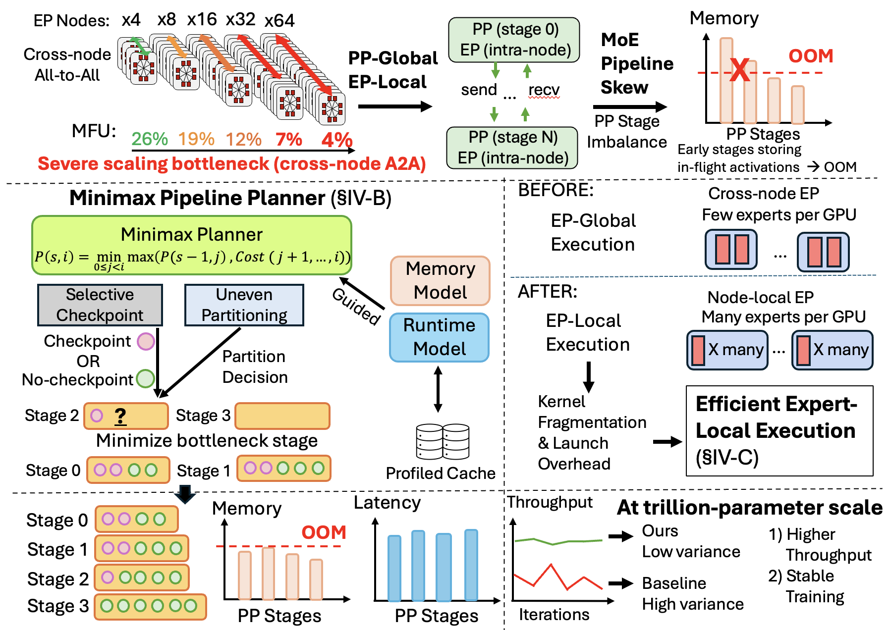
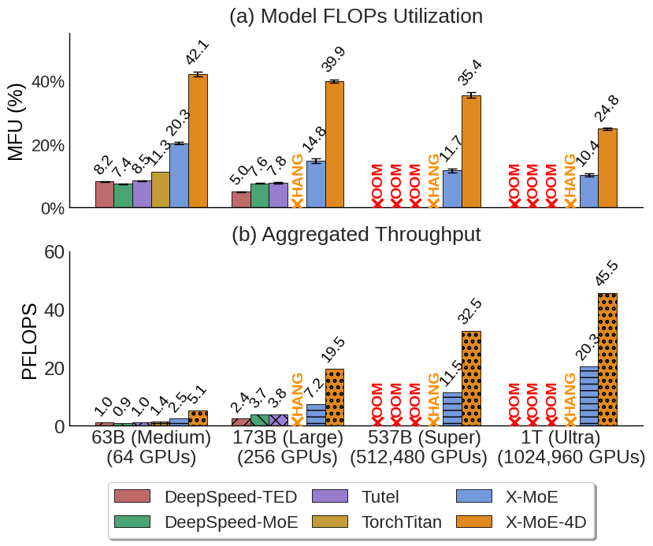
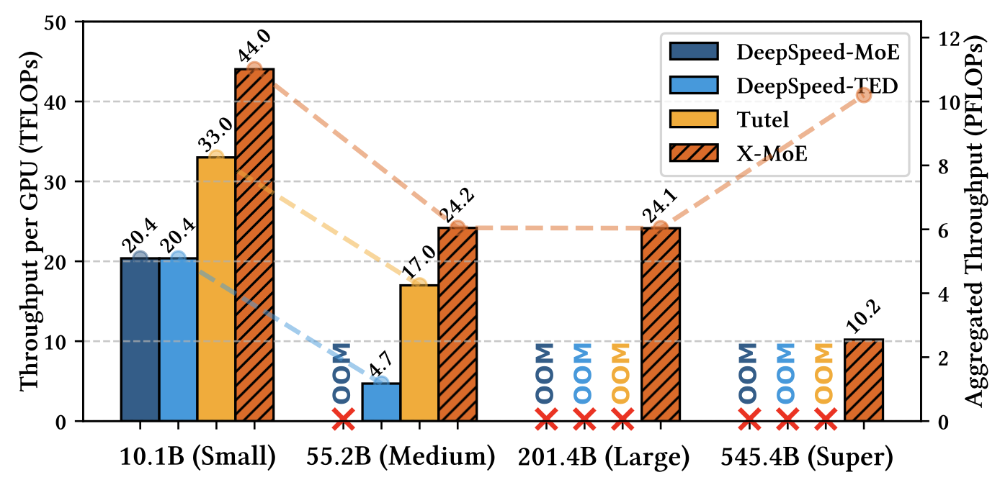

# X-MoE-4D: Breaking the Scaling Barrier for Trillion-Parameter MoEs on Hierarchical HPC Systems

<p align="center">
  
</p>

<p align="center"><em>Overview of X-MoE-4D (Figure 5 of the paper). Scaling expert parallelism across nodes is limited by
the cross-node all-to-all. Pipeline-global, expert-local execution removes it but introduces MoE Pipeline Skew, which
ELM-PP mitigates by balancing the pipeline stages. Grouped-GEMM expert kernels improve the utilization of the experts.</em></p>

<p align="center">
  <a href="https://supercomputing-system-ai-lab.github.io/projects/x-moe/"></a>
  <a href="https://doi.org/10.5281/zenodo.22103995"></a>
  
  
</p>

This repository contains two systems for training expert-specialized Mixture-of-Experts (MoE) models on HPC
platforms. **X-MoE-4D** (SC 2026), described first, scales training with intra-node expert parallelism and inter-node
pipeline parallelism. **X-MoE** (SC 2025), described in the [second part](#x-moe-sc-2025), introduced the
padding-free MoE layer, redundancy-bypassing dispatch and sequence-sharded MoE blocks, which X-MoE-4D also uses.

## 📢 News
- **SC 2026**: X-MoE-4D has been accepted at **SC 2026**. The artifact of the paper is archived at
  [10.5281/zenodo.22103995](https://doi.org/10.5281/zenodo.22103995).
- **2025-07-14**: X-MoE's code released.
- **2025-06-26**: X-MoE has been accepted at **SC 2025** and received a **Best Student Paper Nomination**.

---

# X-MoE-4D (SC 2026)

## 🚀 About

X-MoE scales out MoE training along the expert-parallel dimension, so the all-to-all communication of every MoE layer
crosses the network between nodes. On Frontier, this communication limits X-MoE to 10.2 TFLOP/s per GPU for a
545B-parameter model on 1,024 GPUs. X-MoE-4D keeps the expert-parallel all-to-all inside a node and distributes the
layers across nodes with pipeline parallelism (*pipeline-global, expert-local* execution). Fine-grained MoE layers
make the memory of the early pipeline stages much larger than that of the late stages (*MoE Pipeline Skew*). The
X-MoE-4D planner, **ELM-PP**, chooses the layers and the recomputed layers of every stage so that the slowest stage is
as fast as possible within the memory limit.

On Frontier (AMD MI250X), X-MoE-4D trains a 1T-parameter MoE model at 24.8 % MFU on 960 GPUs, 2.24 times the
throughput of X-MoE on 1,024 GPUs. On a 173B-parameter model, it maintains 36 % MFU in weak scaling up to 1,152 GPUs,
and at 2,304 GPUs it is 3.24 times faster than X-MoE on 2,048 GPUs. On Frontier, a GPU is one GCD of an MI250X.

X-MoE-4D is built on [DeepSpeed](https://github.com/deepspeedai/DeepSpeed) and
[Megatron-DeepSpeed](https://github.com/deepspeedai/Megatron-DeepSpeed). It is tested on the Frontier supercomputer
(AMD MI250X) and on AWS p4d nodes (NVIDIA A100-40GB).

## ✨ Features

- **Uneven pipeline stages** (`--uneven-pp-partition 7 8 8 9`): each pipeline stage holds the number of transformer
  layers given for it, instead of an equal share. Under the 1F1B schedule, the first stage keeps the activations of more
  micro-batches in memory than the last one, so an equal split leaves memory unused on the later stages.
- **Activation checkpointing per stage** (`--dynamic-checkpoint-partition 1 0 0 0`): on each stage, the first *n*
  transformer layers recompute their activations in the backward pass, and the other layers keep them.
- **ELM-PP planner** (`ELM_PP_launch.py --run-planner true`): a dynamic program that chooses the layers and the
  checkpointed layers of every stage so that the slowest stage is as fast as possible while every stage fits a memory
  limit. It then picks the micro-batch size with a model of the pipeline step time. Its inputs are the per-layer
  forward times of a one-node profiling run and an analytic memory model
  ([`deepspeed/moe/planner/`](deepspeed/moe/planner)). The planner runs once, before training, on CPU.
- **Grouped-GEMM experts**: all local experts in one kernel, either the Triton kernel (`--use-groupedGEMM
  --use-triton`, NVIDIA and AMD) or the Composable Kernel grouped GEMM of
  [Primus-Turbo](https://github.com/AMD-AGI/Primus-Turbo) (`--use-groupedGEMM` with `USE_AITER_GROUPGEMM=True`, AMD;
  the bundled fork adds MI250X support).
- **Two launch paths with the same modes**: Slurm (`scripts-frontier/`) and `torchrun` over ssh for machines without
  Slurm (`scripts/`).
- **The X-MoE layer**: X-MoE-4D runs on X-MoE's padding-free MoE layer, and its flags (PFT, RBD, SSMB) work in
  X-MoE-4D runs as well (see [X-MoE](#x-moe-sc-2025)).

## 🏁 Quick Start

### 1. Clone, with the pinned submodules
```bash
git clone --recurse-submodules https://github.com/Supercomputing-System-AI-Lab/X-MoE
cd X-MoE
```
Do not pass `--remote` to `git submodule update`: it moves the submodules from the pinned commits to their branch
tips.

### 2. Build the environment
```bash
./setup_env_rocm.sh    # AMD, tested on Frontier (ROCm 6.4.1, torch 2.9.1)
./setup_env_cuda.sh    # NVIDIA, tested on the AWS Deep Learning AMI (CUDA 12.8, torch 2.9.1)
```
Each script builds a conda environment with torch, apex, FlashAttention and mpi4py, and installs X-MoE and
Megatron-DeepSpeed-X-MoE in editable mode. `XMOE4D_ROOT` sets where the environment, the dependencies and the caches
go (by default, next to the checkout). `./setup_env_rocm.sh <stage>` reruns one stage. FlashAttention is required,
because the example templates pass `--use-flash-attn-v2`. The manual installation on Frontier is described in
[`x-moe-docs/frontier-installation-guide.md`](x-moe-docs/frontier-installation-guide.md).

### 3. Prepare the sample data
```bash
cd Megatron-DeepSpeed-X-MoE/examples_xmoe_4d/data
bash prepare_data_ae.sh
```
For your own data, use Megatron's data format
([Megatron data preparation](https://github.com/NVIDIA/Megatron-LM?tab=readme-ov-file#data-preparation)).

### 4. Validate the installation
With `torchrun` (one node, 8 GPUs):
```bash
cd Megatron-DeepSpeed-X-MoE/examples_xmoe_4d/scripts
./run_exp_training.sh env_validate
```
With Slurm on Frontier, the job runs in the environment of the shell that submits it, so load the modules and activate
the environment first:
```bash
module reset
module load cpe/24.11 PrgEnv-gnu/8.6.0 rocm/6.4.1 cray-mpich/9.1.0 craype-accel-amd-gfx90a miniforge3/23.11.0-0 ninja
export LD_LIBRARY_PATH=/opt/cray/pe/mpich/9.0.0/gtl/lib:$LD_LIBRARY_PATH   # see the note below
conda activate <XMOE4D_ROOT>/XMoE4D_envs/X-MoE-4D-ROCM6.4.1_repro
source <XMOE4D_ROOT>/XMoE4D_deps/xmoe_4d_runtime_env.sh    # written by ./setup_env_rocm.sh aws-ofi-rccl
export SBATCH_ACCOUNT=<your project>
cd Megatron-DeepSpeed-X-MoE/examples_xmoe_4d/scripts-frontier
./run_exp_training.sh env_validate
```
`env_validate` trains X-MoE 10B for 10 iterations on one node (pipeline size 2, expert-parallel size 4). The first run
compiles kernels, which can take about ten minutes more. `xmoe_4d_runtime_env.sh` puts the aws-ofi-rccl network
plugin on the library path and sets the C and C++ compilers to GCC 13, which PyTorch requires for the kernels that are
compiled at run time.

**Note on Frontier's programming environment.** Frontier changed its default programming environment on 2026-11-10.
Since then, the GPU transport library of `cray-mpich/9.1.0` requires ROCm 7, and `from mpi4py import MPI` fails under
`rocm/6.4.1` with `libamdhip64.so.7: cannot open shared object file`. The GPU transport library of cray-mpich 9.0.0 is
built for ROCm 6, and the `export` line above puts it first on the library path.

## 🏃 Running X-MoE-4D

`run_exp_training.sh` runs one experiment per command. The
[examples README](https://github.com/Supercomputing-System-AI-Lab/Megatron-DeepSpeed/blob/X-MoE-4D/examples_xmoe_4d/README.md)
describes every mode, the map-driven launcher `autorun_frontier.sh` and the execution flow.

```bash
./run_exp_training.sh profiling_cache X-MoE-4D      # one-node profiles for the planner (once per GPU type)
./run_exp_training.sh training X-MoE-4D             # planner, uneven stages, per-stage checkpointing
./run_exp_training.sh training X-MoE-4D no_planner  # even stages, every layer checkpointed
./run_exp_training.sh training X-MoE-4D TritonGroupGEMM
./run_exp_training.sh training X-MoE                # baselines: X-MoE, DS-MoE, DS-TED, DS-Tutel
./run_exp_training.sh main_results                  # X-MoE-4D with and without the planner, X-MoE, DS-MoE, DS-Tutel
./run_exp_training.sh loss_validate                 # X-MoE-4D against X-MoE on the 10B model
```

The planner profiles measured on Frontier ship in
`examples_xmoe_4d/scripts-frontier/planner_profiling_cache_mi250x/`. On any other GPU, run `profiling_cache` first.
Multi-node `torchrun` needs a host file and a shared file system: see
[`x-moe-docs/aws-multinode-guide.md`](x-moe-docs/aws-multinode-guide.md).

### ⚙️ The flags

| Flag | Effect |
|---|---|
| `--pipeline-model-parallel-size <PP>` | pipeline parallelism |
| `--uneven-pp-partition n0 n1 ...` | transformer layers of each pipeline stage |
| `--dynamic-checkpoint-partition c0 c1 ...` | checkpointed layers of each pipeline stage (with `--checkpoint-activations`) |
| `--use-groupedGEMM [--use-triton]` | grouped-GEMM experts: Triton, or Primus-Turbo with `USE_AITER_GROUPGEMM=True` |
| `ELM_PP_launch.py --run-planner true` | run the planner and pass its partition and checkpoint counts to training |

The X-MoE flags (`--use-uneven-all-to-all --use-pft`, `--use-rbd`, `--tensor-model-parallel-size`) are listed in the
[X-MoE part](#the-x-moe-flags).

## 📊 Evaluation

The results below are from the paper, on Frontier with up to 2,304 GPUs. The models follow the fine-grained
DeepSeek-MoE design: 63B (32 layers, 128 experts, top-6), 173B (24 layers, 256 experts, top-8), 537B (60 layers, 256
experts, top-8) and 1T (60 layers, 512 experts, top-8). Each system uses its highest-throughput configuration.

<p align="center">
  
</p>

X-MoE-4D achieves the highest throughput at every model size. For the 1T model, it reaches 24.8 % MFU on 960 GPUs,
against 10.4 % for X-MoE on 1,024 GPUs (45.5 against 20.3 PFLOP/s, 2.24 times the throughput with 6 % fewer GPUs).
For the 537B model, its MFU is 35.4 %, against 11.7 % for X-MoE. At these two sizes, DeepSpeed-MoE, DeepSpeed-TED
and Tutel run out of memory, and TorchTitan stops at initialization with a collective-communication timeout.

<p align="center">
  
</p>

On the 173B model, X-MoE-4D maintains 36 % MFU in weak scaling up to 1,152 GPUs, while the MFU of X-MoE decreases
from 15.4 % on 256 GPUs to 9.4 % on 1,024 GPUs. In strong scaling with a fixed batch of 19,200 sequences, X-MoE-4D
reduces the step time from 325.7 s on 288 GPUs to 43.1 s on 2,304 GPUs, and it is 3.24 times faster than X-MoE on
2,048 GPUs. On 480 GPUs, the ELM-PP plan improves the MFU over recomputation in every stage by 6.4 % for the 537B
model and by 15.3 % for the 1T model.

## 📝 Citation
```
@inproceedings{wang2026xmoe4d,
  title     = {X-MoE-4D: Breaking the Scaling Barrier for Trillion Parameter MoEs on Hierarchical HPC Systems},
  author    = {Zixian Wang and Liheng Jing and Emily Herron and Sajal Dash and Feiyi Wang and Minjia Zhang},
  booktitle = {Proceedings of the International Conference for High Performance Computing, Networking, Storage and
               Analysis (SC '26)},
  year      = {2026}
}
```

---

# X-MoE (SC 2025)

<p align="center">
  
</p>

## 🚀 About

[X-MoE](https://arxiv.org/abs/2508.13337) trains DeepSeek-style MoE models with many fine-grained experts on HPC
platforms. It reduces the memory and the communication of the MoE layer with three mechanisms, and it trains models of
up to 545B parameters on 1,024 GPUs of Frontier, 10 times larger than existing solutions under the same hardware
budget, with up to 1.42 times higher training throughput.

## ✨ Features

- **Padding-Free Token buffers (PFT)** (`--use-uneven-all-to-all --use-pft`): the MoE layer stores only the routed
  tokens, with no zero padding to the expert capacity, through gating, dispatch, the experts and combine.
- **Redundancy-Bypassing Dispatch (RBD)** (`--use-rbd`): a token that goes to several experts on one remote node
  crosses the network once and is copied to its experts inside that node.
- **Sequence-Sharded MoE Blocks (SSMB)** (`--tensor-model-parallel-size <TP>` without
  `--enable-expert-tensor-parallelism`): the attention is tensor-parallel, and each tensor-parallel rank runs the MoE
  block on its share of the tokens, which divides the MoE activation memory by the tensor-parallel size.

### The X-MoE flags

| Flag | Effect |
|---|---|
| `--use-uneven-all-to-all --use-pft` | X-MoE's padding-free MoE layer |
| `--use-rbd` | redundancy-bypassing dispatch (requires the two flags above) |
| `--tensor-model-parallel-size <TP>` | tensor parallelism; the MoE blocks are sequence-sharded unless `--enable-expert-tensor-parallelism` is given |

X-MoE uses the same environment as X-MoE-4D ([Quick Start](#-quick-start)). `./run_exp_training.sh training X-MoE`
runs it as a baseline in the X-MoE-4D examples.

## 📊 Evaluation

<p align="center">
  
</p>

## 📝 Citation
```
@misc{yuan2025xmoeenablingscalabletraining,
      title={X-MoE: Enabling Scalable Training for Emerging Mixture-of-Experts Architectures on HPC Platforms},
      author={Yueming Yuan and Ahan Gupta and Jianping Li and Sajal Dash and Feiyi Wang and Minjia Zhang},
      year={2025},
      eprint={2508.13337},
      archivePrefix={arXiv},
      primaryClass={cs.LG},
      url={https://arxiv.org/abs/2508.13337},
}
```

---

## License

Apache-2.0, as DeepSpeed. The code taken from other projects and its licenses are listed in
[`THIRD_PARTY_NOTICES.md`](THIRD_PARTY_NOTICES.md).
