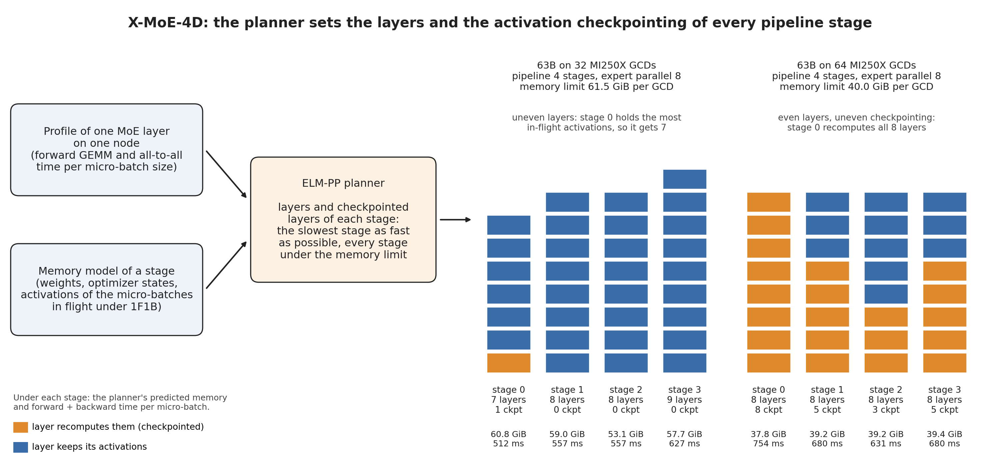

# X-MoE-4D: Pipeline-Parallel Training for Expert-Specialized MoE Models

<!-- Authors: replace the subtitle above with the title of the X-MoE-4D paper once it is public. -->

<p align="center">
  
</p>

<p align="center">
  <a href="https://supercomputing-system-ai-lab.github.io/projects/x-moe/"></a>
  <a href="https://doi.org/10.5281/zenodo.21840750"></a>
  
  
</p>

## 📢 News
- **SC 2026**: X-MoE-4D has been accepted at **SC 2026**. Its code is this branch, `X-MoE-4D`; the artifact of the paper is archived at [10.5281/zenodo.21840750](https://doi.org/10.5281/zenodo.21840750).
- **2025-07-14**: X-MoE's code released (branch `master`).
- **2025-06-26**: X-MoE has been accepted at **SC 2025** and received **Best Student Paper Nomination**.

## 🚀 About
X-MoE-4D trains large **expert-specialized Mixture-of-Experts (MoE)** models (DeepSeek-MoE style: many
fine-grained experts, large top-k) with four dimensions of parallelism: data, expert, tensor with
sequence-sharded MoE blocks, and **pipeline**. It builds on [X-MoE](https://supercomputing-system-ai-lab.github.io/projects/x-moe/)
(SC 2025), which left pipeline parallelism to future work, and adds what pipeline parallelism needs for these
models: stages of uneven size, activation checkpointing chosen per stage, a planner that chooses both under a
memory limit, and grouped-GEMM expert kernels.

X-MoE-4D is built on [DeepSpeed](https://github.com/deepspeedai/DeepSpeed) and
[Megatron-DeepSpeed](https://github.com/deepspeedai/Megatron-DeepSpeed). It is tested on the Frontier
supercomputer (AMD MI250X) and on AWS p4d nodes (NVIDIA A100-40GB).

## ✨ Features

### New in X-MoE-4D

- **Uneven pipeline stages** (`--uneven-pp-partition 7 8 8 9`): each pipeline stage holds the number of
  transformer layers given for it, instead of an equal share. Under the 1F1B schedule the first stage keeps the
  activations of more micro-batches in memory than the last one, so an equal split leaves memory unused on the
  later stages.
- **Activation checkpointing per stage** (`--dynamic-checkpoint-partition 1 0 0 0`): on each stage, the first
  *n* transformer layers recompute their activations in the backward pass and the other layers keep them.
- **ELM-PP planner** (`ELM_PP_launch.py --run-planner true`): a dynamic program that chooses the layers and the
  checkpointed layers of every stage so that the slowest stage is as fast as possible while every stage fits a
  memory limit, then picks the micro-batch size by a model of the pipeline step time. Its inputs are the per-layer
  forward times of a one-node profiling run and an analytic memory model
  ([`deepspeed/moe/planner/`](deepspeed/moe/planner)). The planner runs once, before training, on CPU.
- **Grouped-GEMM experts**: all local experts in one kernel, either the Triton kernel
  (`--use-groupedGEMM --use-triton`, NVIDIA and AMD) or the Composable Kernel grouped GEMM of
  [Primus-Turbo](https://github.com/AMD-AGI/Primus-Turbo) (`--use-groupedGEMM` with `USE_AITER_GROUPGEMM=True`,
  AMD; the bundled fork adds MI250X support).
- **Two launch paths with the same modes**: Slurm (`scripts-frontier/`) and `torchrun` over ssh for machines
  without Slurm (`scripts/`).

### From X-MoE

- **Padding-Free Token buffers (PFT)** (`--use-uneven-all-to-all --use-pft`): the MoE layer stores only the
  routed tokens, with no zero padding to the expert capacity, through gating, dispatch, the experts and combine.
- **Redundancy-Bypassing Dispatch (RBD)** (`--use-rbd`): a token that goes to several experts on one remote node
  crosses the network once and is copied to its experts inside that node.
- **Sequence-Sharded MoE Blocks (SSMB)** (`--tensor-model-parallel-size <TP>` without
  `--enable-expert-tensor-parallelism`): the attention is tensor-parallel and each tensor-parallel rank runs the
  MoE block on its share of the tokens, which divides the MoE activation memory by the tensor-parallel size.

## 🏁 Quick Start

### 1. Clone, with the pinned submodules
```bash
git clone -b X-MoE-4D --recurse-submodules https://github.com/Supercomputing-System-AI-Lab/X-MoE
cd X-MoE
```
Do not pass `--remote` to `git submodule update`: it moves the submodules from the pinned commits to their branch
tips.

### 2. Build the environment
```bash
./setup_env_rocm.sh    # AMD, tested on Frontier (ROCm 6.4.1, torch 2.9.1)
./setup_env_cuda.sh    # NVIDIA, tested on the AWS Deep Learning AMI (CUDA 12.8, torch 2.9.1)
```
Each script builds a conda environment with torch, apex, FlashAttention and mpi4py, and installs X-MoE and
Megatron-DeepSpeed-X-MoE in editable mode. `XMOE4D_ROOT` sets where the environment, the dependencies and the
caches go (by default, next to the checkout); `./setup_env_rocm.sh <stage>` reruns one stage. FlashAttention is
required: the example templates pass `--use-flash-attn-v2`. The manual installation on Frontier is described in
[`x-moe-docs/frontier-installation-guide.md`](x-moe-docs/frontier-installation-guide.md).

### 3. Prepare the sample data
```bash
cd Megatron-DeepSpeed-X-MoE/examples_xmoe_4d/data
bash prepare_data_ae.sh
```
For your own data, use Megatron's data format ([Megatron data preparation](https://github.com/NVIDIA/Megatron-LM?tab=readme-ov-file#data-preparation)).

### 4. Validate the installation
With `torchrun` (one node, 8 GPUs):
```bash
cd Megatron-DeepSpeed-X-MoE/examples_xmoe_4d/scripts
./run_exp_training.sh env_validate
```
With Slurm on Frontier (the job runs in the environment of the shell that submits it, so load the modules and
activate the environment first):
```bash
module reset
module load cpe/24.11 PrgEnv-gnu/8.6.0 rocm/6.4.1 cray-mpich/9.1.0 craype-accel-amd-gfx90a miniforge3/23.11.0-0 ninja
conda activate <XMOE4D_ROOT>/XMoE4D_envs/X-MoE-4D-ROCM6.4.1_repro
source <XMOE4D_ROOT>/XMoE4D_deps/xmoe_4d_runtime_env.sh    # written by ./setup_env_rocm.sh aws-ofi-rccl
export SBATCH_ACCOUNT=<your project>
cd Megatron-DeepSpeed-X-MoE/examples_xmoe_4d/scripts-frontier
./run_exp_training.sh env_validate
```
`env_validate` trains X-MoE 10B for 10 iterations on one node (pipeline size 2, expert-parallel size 4). The first
run compiles kernels, which can take about ten minutes more.

## 🏃 Running X-MoE-4D

`run_exp_training.sh` runs one experiment per command; the
[examples README](https://github.com/Supercomputing-System-AI-Lab/Megatron-DeepSpeed/blob/X-MoE-4D/examples_xmoe_4d/README.md) describes every mode, the map-driven
launcher `autorun_frontier.sh` and the execution flow.

```bash
./run_exp_training.sh profiling_cache X-MoE-4D      # one-node profiles for the planner (once per GPU type)
./run_exp_training.sh training X-MoE-4D             # planner, uneven stages, per-stage checkpointing
./run_exp_training.sh training X-MoE-4D no_planner  # even stages, every layer checkpointed
./run_exp_training.sh training X-MoE-4D TritonGroupGEMM
./run_exp_training.sh training X-MoE                # baselines: X-MoE, DS-MoE, DS-TED, DS-Tutel
./run_exp_training.sh main_results                  # X-MoE-4D with and without the planner, X-MoE, DS-MoE, DS-Tutel
./run_exp_training.sh loss_validate                 # X-MoE-4D against X-MoE on the 10B model
```

The planner profiles measured on Frontier ship in
`examples_xmoe_4d/scripts-frontier/planner_profiling_cache_mi250x/`; on any other GPU, run `profiling_cache` first.
Multi-node `torchrun` needs a host file and a shared file system: see
[`x-moe-docs/aws-multinode-guide.md`](x-moe-docs/aws-multinode-guide.md).

### ⚙️ The flags

| Flag | Effect |
|---|---|
| `--use-uneven-all-to-all --use-pft` | X-MoE's padding-free MoE layer |
| `--use-rbd` | redundancy-bypassing dispatch (needs the two flags above) |
| `--tensor-model-parallel-size <TP>` | tensor parallelism; the MoE blocks are sequence-sharded unless `--enable-expert-tensor-parallelism` is given |
| `--pipeline-model-parallel-size <PP>` | pipeline parallelism |
| `--uneven-pp-partition n0 n1 ...` | transformer layers of each pipeline stage |
| `--dynamic-checkpoint-partition c0 c1 ...` | checkpointed layers of each pipeline stage (with `--checkpoint-activations`) |
| `--use-groupedGEMM [--use-triton]` | grouped-GEMM experts: Triton, or Primus-Turbo with `USE_AITER_GROUPGEMM=True` |
| `ELM_PP_launch.py --run-planner true` | run the planner and pass its partition and checkpoint counts to training |

## ⚠️ Known limitations of this release

These are properties of the code that produced the paper's results. Fixing them changes the training numerics, so
they are not changed in this release.

- **Pipeline runs train without the MoE auxiliary loss.** `ParallelTransformerLayerPipe.forward` drops the
  load-balancing loss, as upstream Megatron-DeepSpeed does; runs with pipeline size 1 keep it.
- **Combine weights are top-k logits.** The padding-free gate (`deepspeed/moe/moe_v2.py`, `topkgating_unbalanced`)
  weights the expert outputs with the top-k raw logits, not with softmax probabilities.
- **Rotary positions in bf16.** With `--bf16` and pipeline size 1, the rotary positions are rounded to bf16, so
  positions above 256 are approximate.
- **Gradient clipping under uneven stages.** With `--uneven-pp-partition`, the model-parallel group that ZeRO
  reduces the gradient norm over is the tensor-parallel group, so each pipeline stage clips with its own norm.
- **Router gradients under tensor parallelism.** With SSMB, the router gradients are not summed over the
  tensor-parallel ranks.
- **Checkpoints of grouped-GEMM experts.** Saving a checkpoint with `--use-groupedGEMM` fails; the examples do not
  save checkpoints.
- **Expert biases differ between kernels.** The sequential experts keep a bias per expert on both projections; the
  Triton kernel shares one up-projection bias; the Primus examples pass `--disable-bias-linear`. Pass
  `--disable-bias-linear` to all three when comparing them.
- Megatron's `--sequence-parallel` and Ulysses sequence parallelism are not supported in this release.

## 📊 Evaluation

<!-- Authors: add the X-MoE-4D result figure and its numbers from the paper here. -->

X-MoE (SC 2025) trains DeepSeek-style models of up to 545B parameters on 1,024 AMD GPUs of Frontier, 10 times
larger than existing solutions under the same hardware budget, with up to 1.42 times higher training throughput:

<p align="center">
  
</p>

## 📝 Citation
```
@inproceedings{xmoe4d2026,
  title     = {X-MoE-4D: <title of the SC 2026 paper>},
  author    = {Zixian Wang and Liheng Jing and Emily Herron and Sajal Dash and Feiyi Wang and Minjia Zhang},
  booktitle = {Proceedings of the International Conference for High Performance Computing, Networking, Storage and Analysis (SC)},
  year      = {2026}
}

@misc{yuan2025xmoeenablingscalabletraining,
      title={X-MoE: Enabling Scalable Training for Emerging Mixture-of-Experts Architectures on HPC Platforms},
      author={Yueming Yuan and Ahan Gupta and Jianping Li and Sajal Dash and Feiyi Wang and Minjia Zhang},
      year={2025},
      eprint={2508.13337},
      archivePrefix={arXiv},
      primaryClass={cs.LG},
      url={https://arxiv.org/abs/2508.13337},
}
```

## License

Apache-2.0, as DeepSpeed. The code taken from other projects and its licenses are listed in
[`THIRD_PARTY_NOTICES.md`](THIRD_PARTY_NOTICES.md).
