# X-MoE-4D: Breaking the Scaling Barrier for Trillion-Parameter MoEs on Hierarchical HPC Systems

Zixian Wang, Liheng Jing, Emily Herron, Sajal Dash, Feiyi Wang, Minjia Zhang · University of Illinois Urbana-Champaign and Oak Ridge National Laboratory

*13-minute read*

X-MoE, the previously largest scale of MoE training shown on the Frontier HPC system, achieves only 10.2 TFLOP/s per GPU (5.3 % model FLOPs utilization, MFU) for 545 billion parameters on 1,024 GPU dies (GCDs),
showing a strong limitation in scaling up large-scale MoE training on Frontier. In this work, we study the scaling bottleneck on the Frontier system, and we propose an
alternative scaling pathway. In this blog, we present X-MoE-4D, which scales out MoE
training via intra-node expert parallelism (EP) and inter-node pipeline parallelism (PP). X-MoE-4D further pushes the
limits of trainability on HPC clusters to 1-trillion-parameter MoE models, achieving 24.8 % MFU on 960 GCDs.
Its throughput is 2.24 times that of X-MoE on 1,024 GCDs. On a 173-billion-parameter model, X-MoE-4D maintains 36 % MFU
in weak scaling up to 1,152 GCDs, and in strong scaling to 2,304 GCDs it is 3.24 times faster than X-MoE on 2,048 GCDs.
The paper is accepted to SC 2026, and the code is available in the [X-MoE
repository](https://github.com/Supercomputing-System-AI-Lab/X-MoE).

## 1. The scaling trend of MoE models

This limitation matters because MoE models continue to grow. Recent open-weight MoE language models increase both the total number of parameters and the number of *experts* per layer (Figure 1). DeepSeek-V3, released in December 2024, has 671 billion parameters and 256 experts per layer. Kimi K3, released 19 months later in July 2026, has 2.8 trillion parameters and 896 experts per layer, 4.2 times the parameters and 3.5 times the experts of DeepSeek-V3. GLM-5, MiniMax-M2 and Muse Spark also use 256 experts per
layer. Each token activates only a small fraction of the parameters: 37 of 671 billion in DeepSeek-V3 and 104 billion of 2.8 trillion in Kimi K3.
Sparse activation therefore lets the parameter count grow much faster than the compute per token. The next section explains how an MoE layer activates only part of its parameters.

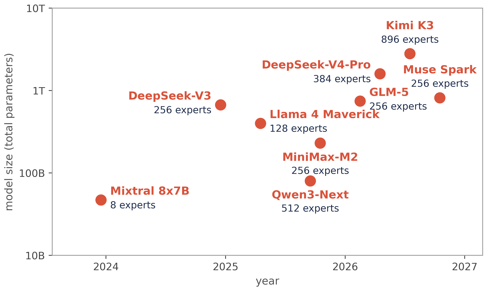

<p class="figure-caption">Figure 1: Total parameters and experts per MoE layer of open MoE models, by release date.
Sources: expert counts from the published configuration of each model; total parameter counts from its technical report, model card or release
announcement.</p>

## 2. What is an MoE model?

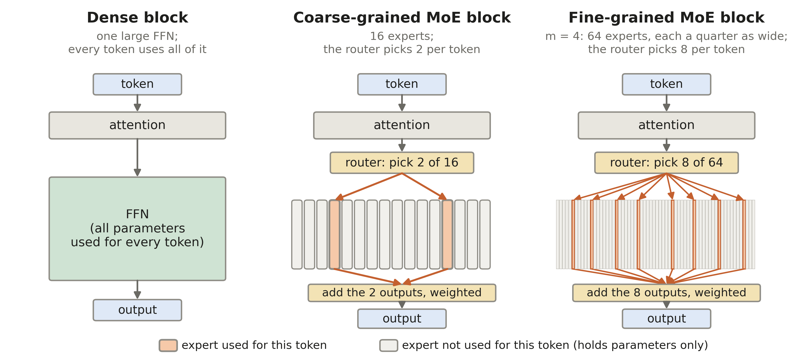

<p class="figure-caption">Figure 2: Left: a dense transformer layer processes every token with one feed-forward network (FFN). Middle: a coarse-grained MoE layer has 16 experts, and the router selects 2 for each token. Right: a
fine-grained MoE layer with m = 4 splits each expert into 4 experts of a quarter of the width and selects 8 of the
resulting 64 for each token, at the same compute per token.</p>

**Dense transformer.** A language model processes text as a sequence of *tokens*, which are words or parts of words.
Each token passes through a stack of layers. In a *dense* transformer, each layer consists of two blocks (Figure 2, left): an *attention* block, which combines
information from the preceding tokens, and a *feed-forward network* (FFN). Every token is multiplied by all FFN weights,
so the compute per token increases in proportion to the model size.

**Coarse-grained MoE.** An MoE layer breaks this proportionality. It replaces the single FFN with several FFNs of the same size, called *experts*, and
adds a small *router* that selects, for each token, the experts that process it. Mixtral 8x7B, for example, has 8
experts per layer and routes each token to 2 of them: the model has 47 billion parameters, but each token activates
about 13 billion. We call this design *coarse-grained*: a small number of large experts, with one or two selected per
token. Figure 2 (middle) shows a coarse-grained layer with 16 experts, of which the router selects 2 per token. With so few experts selected per token, a coarse-grained layer offers only a small number of expert combinations.

**Fine-grained MoE.** [DeepSeek-MoE](https://arxiv.org/abs/2401.06066) (2024) increased the number of combinations with *fine-grained* experts: it splits each expert into m experts, each with 1/m of the intermediate dimension, and increases the number of experts
selected per token (the *top-k*, the k highest-scoring experts) by the same factor m. The compute per token therefore
remains the same, and the number of possible expert combinations increases. Figure 2 (right) shows this with m = 4: the
16 experts of the coarse-grained layer become 64 experts of a quarter of the width, and the router selects 8 experts
instead of 2. The number of ways to select k of n experts is the binomial coefficient C(n, k) = n! / (k! (n - k)!). It
increases from C(16, 2) = 120 for the coarse-grained layer to C(64, 8) = 4,426,165,368 for the fine-grained layer. The
larger number of combinations allows each expert to specialize in a narrower set of tokens, which improves model
quality at the same compute per token. Most models in Figure 1 are fine-grained: DeepSeek-V3 routes each token to 8 of
256 experts, and Kimi K3 to 16 of 896. Training models with this many experts and parameters requires distributing them across many GPUs.

## 3. The challenge of training MoE on an HPC cluster

A 1T-parameter MoE model does not fit in the memory of one GPU or one node. Training stores about 16 bytes per parameter (its value, its gradient and its optimizer state), so a 1T model requires about 16 TB of memory, excluding the *activations*, the intermediate results of the forward pass that the backward pass reuses. A Frontier *node* has 4 AMD MI250X GPUs; each GPU consists of 2 GCDs with 64 GB of memory each, 512 GB per node in total. We use GCD and GPU interchangeably in this post. The model must
therefore be distributed across hundreds of GCDs. The standard method to distribute an MoE model is **expert parallelism (EP)**: the
experts of each layer are distributed across a group of GCDs, the *EP group*; EP 128 denotes an EP group of 128 GCDs. In every MoE layer, each GCD sends each of its tokens to the
GCDs that hold the selected experts (the *dispatch*), the experts process the tokens, and the results are returned to
the original GCDs (the *combine*; Figure 3). Both steps are *all-to-all* communication: every GCD in the group exchanges
data with every other GCD, in every MoE layer, in both the forward pass, which computes the outputs, and the backward pass, which computes the gradients. The cost of this all-to-all therefore depends on the links between the GCDs, inside a node and across nodes.

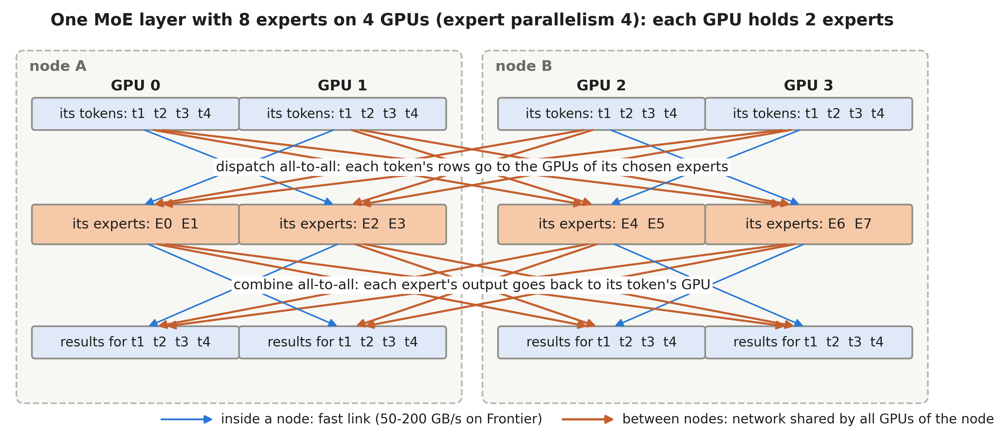

<p class="figure-caption">Figure 3: Expert parallelism. The 8 experts of one MoE layer are distributed across 4 GCDs (labelled GPU) on two nodes. The dispatch all-to-all sends each token to the GCDs of its selected experts, and the combine all-to-all
returns the results. Transfers between nodes (orange) share the node's network links.</p>

### 3.1 The hierarchical network of an HPC cluster

Across nodes, Frontier uses the HPE Slingshot interconnect in a *dragonfly* topology. A dragonfly has two levels:
the switches within a group are fully connected, and the groups are fully connected to each other. Each Slingshot
switch has three kinds of links, each of 25 GB/s. Its 16 edge links connect to the network ports of compute nodes, and
each node has 4 such ports. Its 31 local links connect it directly to each of the other 31 switches of its group. Its
16 global links connect it to switches in other groups. A group of 32 switches serves the 128 nodes of one cabinet, so
on Frontier a group is a cabinet. Frontier has 74 groups, and every pair of groups is connected by 4 global links. A
minimal route between two nodes in different groups therefore uses at most one local link in each group and one global link between the groups. For an all-to-all, the relevant quantity is how many GCDs share each of these links.

The farther a link reaches, the more GCDs share it (Figure 4). Inside a node, two GCDs exchange data over Infinity
Fabric, AMD's direct GPU-to-GPU interconnect, at 50 to 200 GB/s. Each such link serves one pair of GCDs. A node
connects to the switches through 4 links of 25 GB/s, 100 GB/s in total, and its 8 GCDs share them. Two switches of the
same cabinet are connected by one direct link of 25 GB/s. Each switch connects to 16 node ports, and each port carries
the traffic of 2 GCDs, so up to 32 GCDs share this link. Two cabinets are connected by 4 direct links, 100 GB/s in
total. Up to 1,024 GCDs, the 128 nodes of a cabinet, share these links between two cabinets, together with the other jobs on the system.
These numbers count direct links only. Adaptive routing can also send traffic through other switches and cabinets. An
all-to-all completes only when its slowest transfer completes, so an all-to-all across nodes is bounded by these shared network links. The existing systems discussed next reduce the data that crosses these links, but their all-to-all still crosses them.

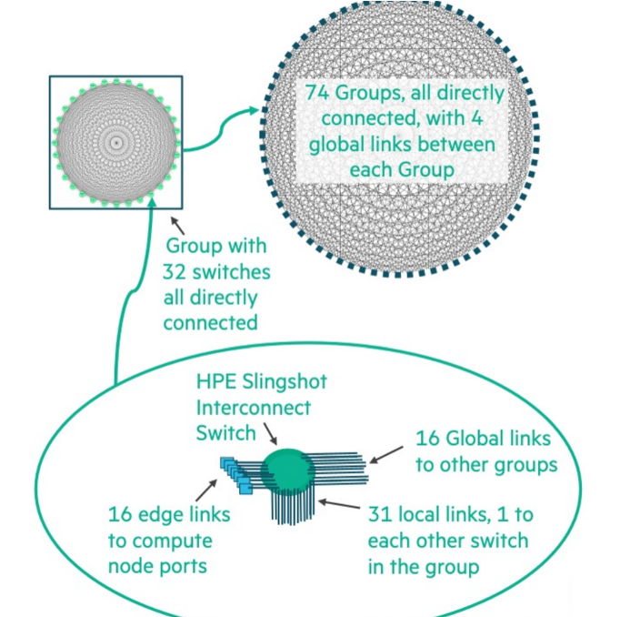

<p class="figure-caption">Figure 4: The HPE Slingshot dragonfly network of Frontier: each switch has 16 edge links to
node ports, 31 local links to the other switches of its group and 16 global links to other groups; 74 groups are all
directly connected. Source: OLCF, Frontier Architecture Overview (S. Abraham, 2024).</p>


### 3.2 Why existing work falls short on an HPC cluster

**X-MoE reduces the all-to-all volume but does not remove the cross-node all-to-all.**
[X-MoE](https://arxiv.org/abs/2508.13337) (SC 2025) introduced three optimizations. *Padding-free* buffers remove the
zero padding that earlier systems store and send to fill the fixed-capacity buffer of each expert.
*Redundancy-bypassing dispatch* (RBD) sends a token once to each node that holds at least one of its selected experts,
instead of once per expert, and copies it to the selected experts inside the node. *Sequence-sharded MoE blocks* (SSMB)
partition the tokens of each MoE layer across the GCDs of a tensor-parallel group (Section 4), which reduces the memory
that the dispatched tokens occupy on each GCD. With these optimizations, X-MoE trained a 545B model on 1,024 GCDs of
Frontier, a model 10 times larger than earlier systems could train on the same hardware. However, even with these
techniques, the EP inter-node all-to-all is still the bottleneck.

**The cost of scaling expert parallelism.** To quantify this bottleneck, we ran one MoE layer with X-MoE and measured how the all-to-all grows with the EP group. The layer has 1,024 experts, each with the hidden size and the expert width of the 1T model. We increased
the EP group from 16 to 512 GCDs at a fixed amount of computation per GCD (Figure 5). With perfect scaling, the layer
time would remain at about 84 ms. The measured time is 241 ms at EP 128 and 501 ms at EP 512. From EP 128 upward, the
dispatch and combine account for most of the layer time (82 % to 91 % at EP 256 to 512), and the layer time varies
between training steps (parameter updates) with a standard deviation of up to 300 ms. The MFU decreases from 26.4 % at EP 16 to 4.3 % at EP 512. Two common remedies target this cost: overlapping the all-to-all with computation, and faster all-to-all kernels.

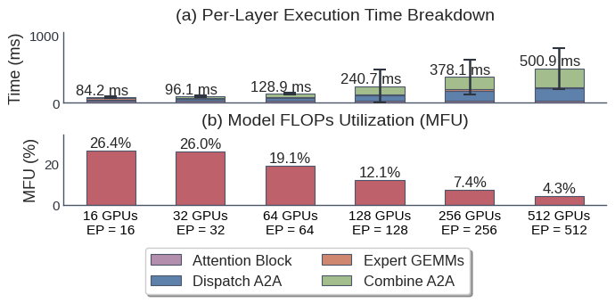

<p class="figure-caption">Figure 5: One MoE layer with 1,024 experts on Frontier, run with X-MoE at a fixed amount of computation per GCD. As expert parallelism (EP) increases from 16 to 512 GCDs, (a) the dispatch and combine all-to-alls (A2A)
dominate the layer time, and (b) MFU decreases from 26.4 % to 4.3 %. Error bars: standard deviation (300 ms at EP
512).</p>

**Faster communication kernels and overlap do not remove this cost.** Neither remedy changes the result, because in a large EP group the all-to-all already outweighs the computation. At EP 256 to 512 in Figure 5, the dispatch and combine take 82 % to 91 % of the layer time,
4.5 to 9.9 times the computation time. Overlapping the all-to-all with computation, as Megatron-Core and DeepSeek's
DualPipe schedule do, can hide only as much communication time as there is computation time to run concurrently. At EP
512, perfect overlap would therefore reduce the 501 ms layer time by at most its 9 % of computation, about 46 ms. The
layer would still take about 455 ms, 5.4 times the 84 ms of perfect scaling. Faster all-to-all kernels do not change
this balance either. As our [X-MoE blog
post](https://supercomputing-system-ai-lab.github.io/blogs/blog/x-moe-scaling-deepseek-style-moes-on-frontierwhat-broke-what-we-fixed-and-what-to-learn/)
describes, the leading MoE training frameworks are designed for NVIDIA GPUs. DeepEP, DeepSeek's expert-parallel
communication library, requires NVIDIA Hopper GPUs and NVIDIA's NVSHMEM library. Megatron-Core does not provide stable
support for ROCm, AMD's GPU software platform, on MI250X at this scale, so we do not include it as a baseline. Where
such kernels are available, they send each token at most once per destination node, as RBD does. These transfers still cross the same shared network links. Removing this cost therefore requires keeping the all-to-all off the network between nodes.

## 4. An alternative scaling pathway

**X-MoE scales out along the EP dimension only.** The cross-node all-to-all follows from how X-MoE scales. X-MoE combines three types of parallelism: *data* parallelism (DP: copies of the model, each processing a different part of the *batch*, the set of sequences of one training step), *tensor* parallelism (TP: each matrix multiplication
partitioned across several GCDs of a node) and expert parallelism. Data parallelism does not reduce the memory per
GCD: for the 1T model, X-MoE stores 256 copies of the attention layers, which use 11.4 GB on every GCD. Tensor parallelism partitions only the attention layers, not the experts, and only across the GCDs of one node, and it adds communication to every layer. A larger model therefore requires a larger EP group,
and a larger EP group spans more nodes. For the 537B model, the highest-throughput X-MoE configuration on 512 GCDs (EP 128, TP 4, activation checkpointing in every layer; Section 6) reaches 11.7 % MFU. For the 1T model, with EP 256 across 32 nodes, it reaches 10.4 % MFU. The MFU of X-MoE also decreases as the number of GCDs increases: on the 173B model, it decreases from 15.4 % on 256 GCDs to
9.4 % on 1,024 GCDs, so 4 times the GCDs provide only 2.4 times the throughput (Figure 12a). An alternative is to keep expert parallelism inside a node and to scale across nodes along a different dimension.

**X-MoE-4D: intra-node expert parallelism and inter-node pipeline parallelism.** X-MoE-4D restricts the all-to-all to the Infinity Fabric links inside a node. It places all experts of a layer on the 8 GCDs of one node (EP 8), so the dispatch and combine use only Infinity
Fabric, and it distributes the layers across nodes with **pipeline parallelism (PP)**: consecutive layers form
*stages* on different nodes, and each stage sends its output to the next stage by point-to-point communication. This layout reduces the cross-node traffic. A stage boundary transfers one vector per token to one neighboring stage. Under cross-node expert parallelism, every MoE layer transfers two vectors per token and selected expert (one in the dispatch, one in the combine), 16 vectors per token for top-8 routing, to up to 8 different nodes. To use more GCDs, X-MoE-4D adds data-parallel replicas of the complete pipeline, and every all-to-all remains inside one node. We call this layout *pipeline-global, expert-local*. When a model also requires tensor parallelism, the layout combines four parallelism dimensions (data, tensor, expert and pipeline), and we therefore name the system X-MoE-4D. This layout moves the scaling across nodes from expert parallelism to pipeline parallelism.

## 5. Three Challenges of pipeline scaling for fine-grained MoE

Pipeline parallelism is a standard method for training dense transformers, but fine-grained MoE layers introduce three challenges for it: higher activation memory, memory concentration on the early stages, and small, inefficient matrix multiplications.

**1. Fine-grained MoE layers require more activation memory.** Pipeline parallelism assumes that the layers can be
partitioned into stages of approximately equal time and memory. This assumption holds for dense models, whose layers are identical
and whose activations are comparatively small. Fine-grained MoE layers violate this assumption: each token is copied once
per selected expert, and the routing buffers and expert outputs increase in proportion to the number of copies. We measured the memory
of each pipeline stage for three models with the same base architecture and the same compute per token: a dense transformer, a
coarse-grained MoE and a fine-grained MoE (Figure 6). The first stage of the fine-grained MoE requires about 58 GB,
more than twice the 25 GB of the dense model, and the difference between its first and last stage is about 40 GB,
compared with about 12 GB for the dense model. The pipeline schedule amplifies this imbalance as the pipeline grows deeper.

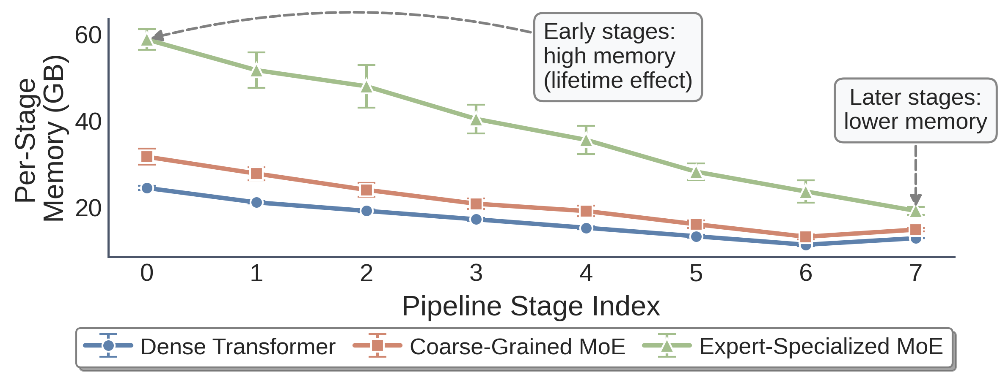

<p class="figure-caption">Figure 6: Memory of each of 8 pipeline stages for a dense transformer, a coarse-grained MoE
and a fine-grained MoE with the same base architecture and compute.</p>

**2. Deeper pipelines concentrate memory on the early stages.** A pipeline divides each training batch into
*micro-batches*, which pass through the stages in sequence so that all stages compute concurrently. Under the common *one-forward-one-backward* (1F1B) schedule, each stage alternates between the forward pass of one micro-batch and the backward pass of another, and it stores the activations of a
micro-batch from its forward pass until its backward pass. Stage s of p stages therefore stores the activations of
about p - s micro-batches (stages numbered from 0): the first stage stores p, and the last stage stores one. With 4 layers per stage, we increased the pipeline depth (the number of stages) from 4 to 8 (Figure 7). The memory of the first stage increases from about
36 GB to about 58 GB, close to the 64 GB of a GCD, while the memory of the last stage remains at about 19 GB. A deeper
pipeline, which is required to distribute a larger model across more nodes, therefore causes the early stages to exceed the 64 GB of a GCD first.

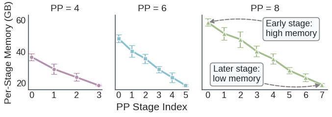

<p class="figure-caption">Figure 7: Memory of each stage of the fine-grained MoE with 4 layers per stage, in pipelines
of 4, 6 and 8 stages (EP 8 in every case).</p>

We call the combined effect of these two challenges **MoE Pipeline Skew**: the early stages exceed the memory limit or,
when they apply activation checkpointing to fit in memory, become the slowest stages, while the late stages have unused memory and idle time. The third challenge, the efficiency of the expert computation, adds to this skew.

**3. Fine-grained experts produce small, inefficient matrix multiplications.** Intra-node expert parallelism places
more experts on each GCD: X-MoE distributes the 512 experts of the 1T model across 256 GCDs, 2 per GCD, while X-MoE-4D
places 64 experts on each GCD. A fine-grained expert is narrow and receives few tokens, so its general matrix
multiplications (GEMMs) are small, and small GEMMs reach a low fraction of the peak compute of a GCD. We measured the
throughput of expert GEMMs for a range of expert widths and tokens per expert (Figure 8). The GEMM shapes of
coarse-grained models such as Mixtral (upper right) reach about 120 TFLOP/s (10^12 floating-point operations per
second), 63 % of the 191 TFLOP/s peak of a GCD. The GEMM shapes of recent fine-grained models such as DeepSeek-V3,
Qwen3-Next and Kimi K2 (lower left) reach less than 100 TFLOP/s. In our 63B model, fine-grained experts increase the
layer time by about 30 % compared with coarse-grained experts of the same compute per token, and an early stage that
applies activation checkpointing executes its forward-pass GEMMs twice. This recomputation adds to MoE Pipeline Skew. The next section describes how X-MoE-4D addresses these three challenges.

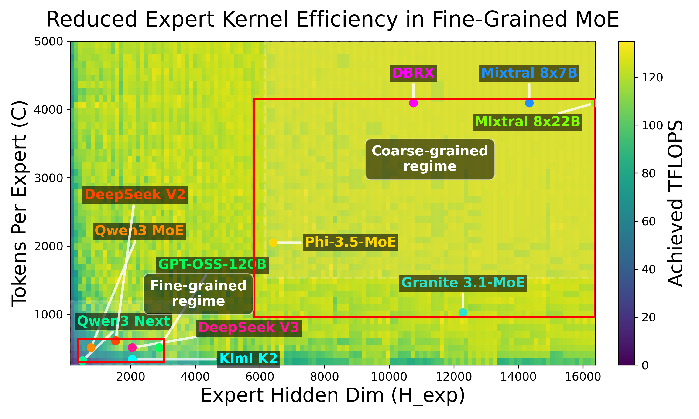

<p class="figure-caption">Figure 8: Throughput of the expert GEMMs on one MI250X GCD as a function of the expert width
(x) and the tokens per expert (y). The labels mark the approximate expert GEMM shapes of recent MoE models.</p>

## 6. Our solution

**ELM-PP minimizes the time of the slowest stage under the memory limit.** X-MoE-4D mitigates MoE Pipeline Skew by deciding, for each stage, how much it recomputes and how many layers it holds. The standard method to reduce activation memory is *activation checkpointing* (also called recomputation): a layer discards its activations after the forward pass and recomputes them
immediately before its backward pass, which increases the compute of the layer by about one third. The baseline systems of Section 7 apply it either to every stage or to no stage. Applied to every stage, it allows the early stages to fit in memory, but it also slows down the late stages, which fit without it. The X-MoE-4D planner, **Expert-Localized Minimax Pipeline Parallelism (ELM-PP)**, is based on one
observation: every micro-batch passes through every stage, so the throughput of a pipeline is determined by its slowest
stage. ELM-PP therefore minimizes the time of the slowest stage (the *minimax* objective), subject to the memory limit
of every stage, through two decisions per stage. *Selective checkpointing* applies activation checkpointing in each stage to only as many layers as the stage needs to fit in memory. *Uneven partitioning* moves layers from the early stages, which are slower because of
recomputation, to the late stages, until the stage times are balanced. A *dynamic program*, an algorithm that builds an optimal solution from the optimal solutions of smaller subproblems, computes both decisions for all stages jointly: it derives the optimal plan for the first s stages from the optimal plans for the first s - 1 stages.
The dynamic program uses two cost models: a time model built from the compute and communication time of each layer, measured once
on one node, and a memory model of the peak memory of each stage (the model state, that is, the parameters, gradients and optimizer state; the activations of the micro-batches that the stage holds between their forward and backward passes; and a fixed reserve). For the 1T model, the memory model differs from the measured peak memory by 0.975 GB per stage on
average, and the time model differs from the measured stage time by 1.4 % without recomputation and 2.3 % with
recomputation. The planner computes a plan for the 60-stage pipeline of the 1T model in seconds. Figure 9 shows the complete system,
including a grouped-GEMM kernel that executes all experts of a GCD in one kernel launch and reduces the kernel-launch overhead of the small GEMMs in Figure 8.

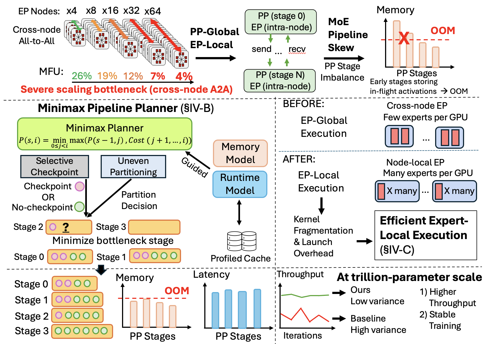

<p class="figure-caption">Figure 9: Overview of X-MoE-4D. Top: scaling expert parallelism across
nodes is limited by the cross-node all-to-all; pipeline-global, expert-local execution removes it but causes MoE
Pipeline Skew, in which the early stages exceed the GCD memory (out of memory, OOM). Bottom left: the minimax planner ELM-PP with its two decisions and two cost models. Right: grouped-GEMM kernels for the 64 experts on each GCD (1T model). Bottom right: lower variation
of the step time at the trillion-parameter scale (Section 7).</p>

**Comparison with standard 1F1B plans.** The effect of these two decisions is visible in a single pipeline schedule. Figure 10 shows the same 4-stage pipeline under three plans. Without recomputation
(top), the schedule is the shortest, but the activations stored by the early stages exceed the memory limit. With
recomputation in every stage (middle), every stage fits in memory, but each backward pass is preceded by a recomputation of its forward pass (pink), which lengthens the schedule. ELM-PP (bottom) recomputes only in the early stages, where the memory limit
requires it, and assigns more layers to the late stages to balance the stage times. Its schedule fits in memory and
finishes earlier than the schedule with recomputation in every stage. The next section measures the effect of this plan, and of intra-node expert parallelism, at scale.

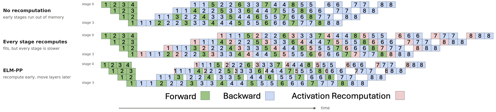

<p class="figure-caption">Figure 10: The same 4-stage pipeline, one row per stage (stage 0 at the top of each
schedule). Numbers are micro-batch indices; time increases from left to right. Top: standard 1F1B without recomputation.
Middle: recomputation in every stage (pink). Bottom: ELM-PP.</p>

## 7. Our results

We compared X-MoE-4D with DeepSpeed-MoE, DeepSpeed-TED, Tutel, TorchTitan and X-MoE on Frontier. For each system, we
searched its configuration space and report the highest-throughput configuration, with a batch of 4,096 sequences
of 4,096 tokens. The four models follow the fine-grained design of Section 2 (Table 1); the 537B model is the 60-layer
version of the largest X-MoE model.

| Model | Layers | Hidden size | Experts | Experts per token | Parameters |
|---|---|---|---|---|---|
| Medium | 32 | 5,120 | 128 | 6 | 63B |
| Large | 24 | 7,168 | 256 | 8 | 173B |
| Super | 60 | 7,168 | 256 | 8 | 537B |
| Ultra | 60 | 7,168 | 512 | 8 | 1T |

<p class="table-caption">Table 1: Model configurations.</p>

**End-to-end throughput.** X-MoE-4D achieves the highest throughput at every model size (Figure 11). For the 1T model, it reaches 24.8 % MFU on 960 GCDs, compared with 10.4 % for X-MoE on 1,024 GCDs. Its aggregate throughput is 45.5 PFLOP/s (10^15 floating-point operations per second), compared with 20.3 PFLOP/s for X-MoE: 2.24 times the throughput with 6 % fewer GCDs. For the 537B model, its MFU is 35.4 %, compared with 11.7 % for X-MoE, a factor of 3.03. For the 537B and 1T models, DeepSpeed-MoE, DeepSpeed-TED and Tutel exceed the GCD memory (out of memory, OOM), and TorchTitan stops at initialization with a collective-communication timeout, so X-MoE is the only baseline that trains these models. Pipeline parallelism also reduces the memory per GCD: it partitions the attention layers across 60 stages instead of replicating them on 256 data-parallel GCDs, which reduces the model-state
memory per GCD for the 1T model from 41.1 GB to 22.8 GB and leaves more memory for activations. The step time of X-MoE-4D is also more stable: over five runs of the 1T model with a smaller batch, its throughput varies by 0.4 %, compared with 11.8 % for X-MoE. The advantage also grows with the number of GCDs.

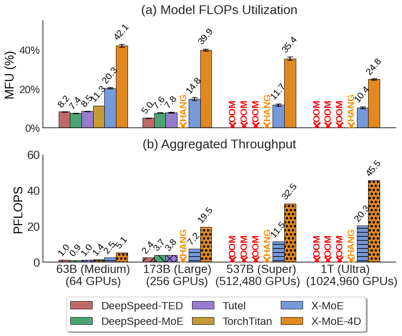

<p class="figure-caption">Figure 11: (a) MFU and (b) aggregate throughput from 63B to 1T on Frontier. OOM: out of
memory. HANG: the run stops at initialization with a collective-communication timeout (TorchTitan 0.2.0, PyTorch 2.11, ROCm 7.0.2).</p>

**Weak and strong scaling.** On the 173B model, X-MoE-4D maintains 36 % MFU in weak scaling (batch size proportional to
the number of GCDs) up to 1,152 GCDs, while the MFU of X-MoE decreases from 15.4 % on 256 GCDs to 9.4 % on 1,024 GCDs (Figure 12a). In strong
scaling with a fixed batch of 19,200 sequences, X-MoE-4D reduces the step time from 325.7 s on 288 GCDs to 43.1 s on
2,304 GCDs, a speedup of 7.6 on 8 times the GCDs. X-MoE reduces its step time from 747.1 s on 256 GCDs to 139.6 s on
2,048 GCDs, a speedup of 5.4 on 8 times the GCDs (Figure 12b). At the largest GCD count of each system (2,304 and 2,048 GCDs), X-MoE-4D is 3.24 times faster than X-MoE, and on 576 GCDs it matches the step time of X-MoE on 2,048 GCDs. In both experiments, X-MoE-4D adds data-parallel replicas of a 12-stage pipeline, and every all-to-all remains inside one node, so the number of nodes that an all-to-all spans does not increase with the number of GCDs. Within each pipeline, the planner contributes a further part of the gain.

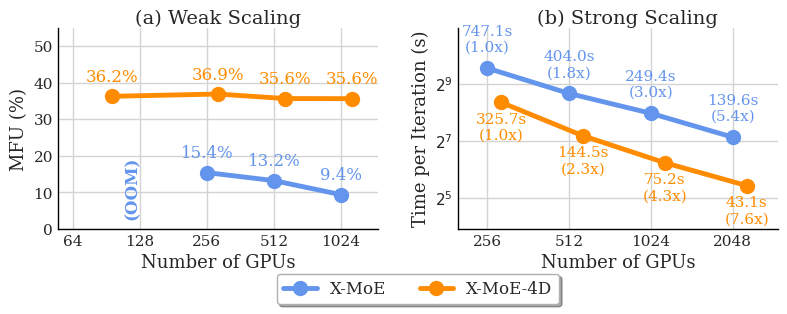

<p class="figure-caption">Figure 12: X-MoE-4D and X-MoE on the 173B model. (a) Weak scaling: MFU with the batch size
proportional to the number of GCDs. (b) Strong scaling: step time for a fixed batch of 19,200 sequences.</p>

**Contribution of the planner.** On 480 GCDs, we compared ELM-PP with simpler plans for the same pipeline (Figure 13).
These runs use half the GCDs of the 1T run in Figure 11, so their MFU values differ from those in Figure 11. For the 537B model (30 stages of 2 layers each), both an even partition and a memory-balanced partition exceed the memory limit without recomputation.
With recomputation in every stage, the even partition reaches 33.0 % MFU and the memory-balanced partition 31.9 %.
ELM-PP reaches 35.1 %, a relative improvement of 6.4 % over the even partition. For the 1T model (60 stages of one layer each),
uneven partitioning cannot move any layer, and the entire improvement results from selective checkpointing: 21.9 % MFU compared
with 19.0 % with recomputation in every stage, a relative improvement of 15.3 %.

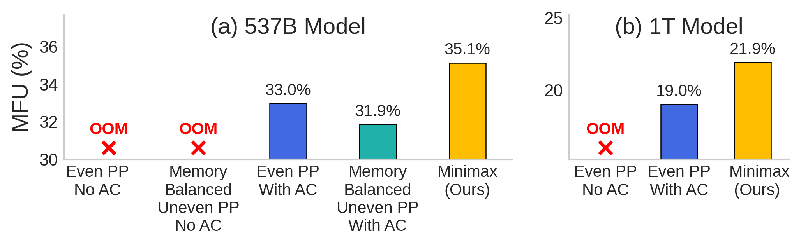

<p class="figure-caption">Figure 13: ELM-PP on 480 GCDs. Even PP: the layers partitioned evenly; AC: activation
checkpointing (recomputation) in every stage; Memory Balanced: a partition that balances the memory of the stages.</p>

## 8. Conclusion

MoE models increase in parameter count and expert count. The standard training method, expert parallelism across nodes, requires an all-to-all over the shared network links between nodes in every MoE layer. X-MoE-4D restricts the all-to-all to the GCDs of one node and distributes the layers across nodes with pipeline parallelism. This layout causes MoE Pipeline Skew, which
ELM-PP mitigates by applying activation checkpointing only in the stages that would otherwise exceed the memory limit and by balancing the stage
times. On Frontier, X-MoE-4D trains a 1T model at 24.8 % MFU on 960 GCDs. On the 173B model, it maintains 36 % MFU in weak scaling up to 1,152 GCDs, and it keeps 94 % of its per-GCD throughput in strong scaling up to 2,304 GCDs. The paper describes the design, the cost models and the complete evaluation. To cite X-MoE-4D:

```
@inproceedings{wang2026xmoe4d,
  title     = {X-MoE-4D: Breaking the Scaling Barrier for Trillion Parameter MoEs on Hierarchical HPC Systems},
  author    = {Zixian Wang and Liheng Jing and Emily Herron and Sajal Dash and Feiyi Wang and Minjia Zhang},
  booktitle = {Proceedings of the International Conference for High Performance Computing, Networking,
               Storage and Analysis (SC '26)},
  year      = {2026}
}
```

## 9. Try it

X-MoE-4D is open source in the [X-MoE repository](https://github.com/Supercomputing-System-AI-Lab/X-MoE), with environment setup scripts for AMD and NVIDIA GPUs. To run it on Frontier:

```bash
git clone --recurse-submodules https://github.com/Supercomputing-System-AI-Lab/X-MoE
cd X-MoE && ./setup_env_rocm.sh                  # ./setup_env_cuda.sh on NVIDIA GPUs
cd Megatron-DeepSpeed-X-MoE/examples_xmoe_4d
(cd data && bash prepare_data_ae.sh)             # a small sample dataset
cd scripts-frontier                              # Slurm launcher; scripts/ uses torchrun instead
./run_exp_training.sh env_validate               # a 10B model on one node: checks the environment
./run_exp_training.sh profiling_cache X-MoE-4D   # measures the layer times that the planner uses
./run_exp_training.sh training X-MoE-4D          # trains with the ELM-PP plan
```

The environment script installs ROCm 6.4.1 and PyTorch 2.9.1 on Frontier. The README in `examples_xmoe_4d` lists the
model sizes and the steps to reproduce the experiments of the paper. The artifact of the paper is archived at
[10.5281/zenodo.22103995](https://doi.org/10.5281/zenodo.22103995). We are also contributing ELM-PP, together with RBD and SSMB from X-MoE, to DeepSpeed; a [DeepSpeed blog post](https://github.com/deepspeedai/DeepSpeed/tree/master/blogs/deepspeed-xmoe)
will describe these features.

## 10. Acknowledgements and contributions

We thank the anonymous reviewers and our shepherd, whose feedback improved the paper. We also thank Junqi Yin and Hao Lu
of ORNL for valuable discussions. Our thanks go as well to the DeepSpeed and Megatron-DeepSpeed communities, on whose code
X-MoE-4D is built, and to the MegaBlocks authors, whose open-source kernels X-MoE's padding-free path builds on.

This research was supported by the National Science Foundation (NSF) under Grant No. 2441601. It used resources of the
Oak Ridge Leadership Computing Facility at the Oak Ridge National Laboratory, which is supported by the Office of Science
of the U.S. Department of Energy under Contract No. DE-AC05-00OR22725. The work also used the Delta and DeltaAI systems at
the National Center for Supercomputing Applications (NCSA) and Jetstream2 at Indiana University through allocation
CIS240055 from the Advanced Cyberinfrastructure Coordination Ecosystem: Services & Support (ACCESS) program, which is
supported by NSF grants #2138259, #2138286, #2138307, #2137603 and #2138296. The Delta advanced computing resource is a
collaborative effort between the University of Illinois Urbana-Champaign and NCSA, supported by the NSF (award OAC 2005572)
and the State of Illinois. UIUC SSAIL Lab is supported by research funding from Google, Amazon, Microsoft, IBM and AMD.

Contributions:
Zixian Wang<sup>1</sup>, Liheng Jing<sup>1</sup>, Emily Herron<sup>2</sup>, Sajal Dash<sup>2</sup>, Feiyi Wang<sup>2</sup>,
Minjia Zhang<sup>1</sup>

1: University of Illinois Urbana-Champaign
2: Oak Ridge National Laboratory
